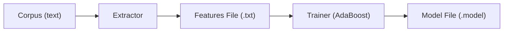
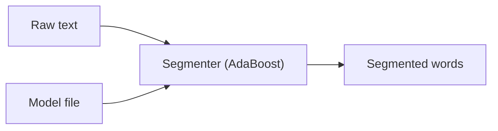

# アーキテクチャ概要

Litsea は、辞書を必要としないコンパクトな単語分割システムとして設計されています。単語分割を**二値分類問題**として扱い、文字レベルの特徴量から単語境界パターンを学習するために **AdaBoost** を使用します。

## 高レベルデータフロー

Litsea には**学習**と**分割**の 2 つの主要なワークフローがあります。品詞付与は、二段構成モデルでこの 2 つを行います（この節の最後で説明します）。

### 学習パイプライン

1. **コーパスの準備** -- 単語をスペースで区切ったテキストを準備
2. **特徴量抽出** -- `Extractor` がコーパスを読み込み、文字を種別に分類し、ラベル付き特徴量ベクトルを出力
3. **モデル学習** -- `Trainer` が特徴量を AdaBoost に入力し、最も情報量の多い特徴量を反復的に選択してコンパクトなモデルを生成

同梱の分割モデルは、同じモデル形式に別の経路で学習しています。2 クラスの Averaged Perceptron として学習し（`litsea train --perceptron`、`PerceptronTrainer`）、`scripts/collapse_binary_perceptron.py` で AdaBoost 形式の重みへ無損失で畳み込みます（[事前学習済みモデル](../pre-trained-models.md#学習手順)を参照）。下の分割パイプラインはどちらのモデルでも同じです。

### 分割パイプライン

1. **モデル読み込み** -- 学習済みモデルを読み込み（ファイルまたは URL から）
2. **文字分類** -- 入力の各文字について、言語固有のパターンに基づいて文字種コードを決定
3. **特徴量抽出** -- スライディングウィンドウを使用し、再利用するバッファを通して各文字位置の文字 n-gram 特徴量をストリーム処理
4. **予測** -- AdaBoost が各位置が単語境界かどうかを予測

### 品詞付与パイプライン

品詞タグは二段構成モデルが付けます。stage 1 は二値の境界分類器で、各文字位置に `B`（ここで単語が始まる）か `O`（単語の続き）を付けます。stage 2 は、分割された各単語に 17 個の UPOS タグのどれかを付けます。`litsea extract --pos` が `word/POS` コーパスから学習用ファイルを書き出し、`litsea train --pos`（`TwoStageTrainer`）がそれらから `litsea-two-stage` モデルを作り、`Segmenter::with_two_stage_learner` と `segment_with_pos()`（`litsea segment --pos`）が入力を分割して品詞を付けます（[二段構成タグ付け](../algorithm/two-stage-tagging.md)を参照）。文字ごとに 18 個の `B-<UPOS>` / `O` ラベルのどれかを予測していた以前の joint モデルは削除されました。そのモデルファイルを読み込むと、`litsea train --pos` で学習し直すよう求めるエラーになります。

## 設計原則

- **辞書は不要** -- MeCab や Lindera とは異なり、Litsea は文字パターンから学習した統計モデルだけで分割する。その上に、任意のユーザー辞書で特定の語を 1 トークンに強制できる（`segment --user-words`、issue #263）
- **コンパクトなモデル** -- 単語分割モデル `japanese`/`chinese`/`korean`/`english.model` は約 86 KB〜2.0 MB（精度は[事前学習済みモデル](../pre-trained-models.md)を参照）。二段構成の品詞モデルは約 3.1-8.3 MB -- いずれもアプリケーションに直接埋め込める程度に小さく、重要な特徴量の重みのみを含む
- **言語非依存のフレームワーク** -- コアアルゴリズムはすべての言語で共通であり、異なるのは文字種パターンと特徴テンプレートの集合のみ（日本語と中国語は 42 テンプレートすべて、韓国語と英語は `WC1`〜`WC4` を除く 38 テンプレートを使う）
- **簡単な拡張性** -- 新しい言語の追加では、文字種パターンを持つ `Language` のバリアントを追加し、`WC` テンプレートを使うかを決め、バインディングの言語一覧に加え、モデルを学習する（[新しい言語の追加](../language-support/adding-a-new-language.md)を参照）
