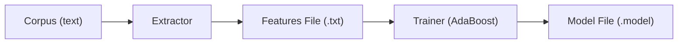
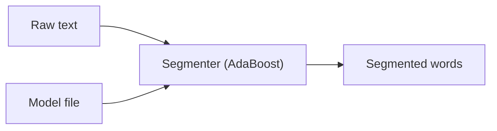

# Architecture Overview

Litsea is designed as a compact word segmentation system that needs no dictionary. It treats word segmentation as a **binary classification problem** and uses **AdaBoost** to learn word boundary patterns from character-level features.

## High-Level Data Flow

Litsea has two main workflows: **training** and **segmentation**. POS tagging runs both with a two-stage model, described at the end of this section.

### Training Pipeline

1. **Corpus preparation** -- Prepare text with words separated by spaces
2. **Feature extraction** -- The `Extractor` reads the corpus, classifies characters by type, and outputs labeled feature vectors
3. **Model training** -- The `Trainer` feeds features into AdaBoost, which iteratively selects the most informative features and produces a compact model

The bundled segmentation models reach the same model format by a different training route: they are trained as a 2-class Averaged Perceptron (`litsea train --perceptron`, `PerceptronTrainer`) and losslessly collapsed into AdaBoost-format weights by `scripts/collapse_binary_perceptron.py` (see [Pre-trained Models](../pre-trained-models.md#training-procedure)). The segmentation pipeline below is the same for both.

### Segmentation Pipeline

1. **Model loading** -- Load a pre-trained model (from file or URL)
2. **Character classification** -- For each character in the input, determine its type code based on language-specific patterns
3. **Feature extraction** -- Stream character n-gram features for each position through a reused buffer using a sliding window
4. **Prediction** -- AdaBoost predicts whether each position is a word boundary

### POS Tagging Pipeline

POS tags come from the two-stage model: stage 1 is a binary boundary classifier that labels each character position `B` (a word starts here) or `O` (continuation), and stage 2 tags each resulting word with one of the 17 UPOS tags. `litsea extract --pos` writes the training files from a `word/POS` corpus, `litsea train --pos` (`TwoStageTrainer`) builds a `litsea-two-stage` model from them, and `Segmenter::with_two_stage_learner` with `segment_with_pos()` (`litsea segment --pos`) segments and tags the input (see [Two-Stage Tagging](../algorithm/two-stage-tagging.md)). The earlier joint model, which predicted one of 18 `B-<UPOS>` / `O` labels per character, was removed; loading such a model file fails with an error that asks you to retrain with `litsea train --pos`.

## Design Principles

- **No dictionary required** -- Unlike MeCab or Lindera, Litsea segments with a statistical model learned from character patterns alone; an optional user dictionary can force specific words into single tokens on top of it (`segment --user-words`, issue #263)
- **Compact models** -- the word-segmentation models `japanese`/`chinese`/`korean`/`english.model` are ~86 KB-2.0 MB (see [Pre-trained Models](../pre-trained-models.md) for their accuracy); two-stage POS models are ~3.1-8.3 MB -- all still small enough to embed directly in applications, containing only the feature weights that matter
- **Language-agnostic framework** -- The core algorithm is the same for all languages; only the character type patterns and the feature-template set differ (Japanese and Chinese use all 42 templates, Korean and English the 38 without `WC1`--`WC4`)
- **Simple extensibility** -- Adding a new language means adding a `Language` variant with its character type patterns, deciding whether it uses the `WC` templates, adding it to the bindings' language lists, and training a model (see [Adding a New Language](../language-support/adding-a-new-language.md))
