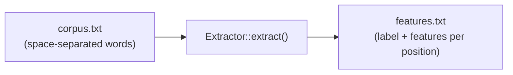

# Extractor

The `Extractor` struct extracts features from a corpus file for model training.

Every method, path-based or [in-memory](#in-memory-extraction), ignores a byte order mark (U+FEFF) at the start of the corpus; anywhere else it is read as text (issue #281).

## Definition

```rust
pub struct Extractor {
    segmenter: Segmenter,
}
```

## Constructor

### `Extractor::new`

```rust
pub fn new(language: Language) -> Self
```

Creates a new extractor for the specified language. Internally creates a `Segmenter` without a pre-trained model. `Extractor` also implements `Default`, which is equivalent to `Extractor::new(Language::Japanese)`.

```rust
use litsea::extractor::Extractor;
use litsea::language::Language;

let extractor = Extractor::new(Language::Japanese);
```

The extraction methods take `&self`, so the binding does not need to be mutable.

## Methods

### `extract`

```rust
pub fn extract(
    &self,
    corpus_path: &Path,
    features_path: &Path,
) -> litsea::Result<()>
```

Reads a corpus file (space-separated words, one sentence per line) and writes the extracted features to the output file.

```rust
use std::path::Path;

extractor.extract(
    Path::new("./corpus.txt"),
    Path::new("./features.txt"),
)?;
```

### Pipeline



The extractor:

1. Reads each line from the corpus file
2. Calls `Segmenter::add_corpus_with_writer()` to process each line
3. Writes a `label\tfeature1\tfeature2\t...` row for each character position except the first (which always starts a word) to the output file, with label `1` (word start) or `-1` (continuation)

### `extract_tsv`

```rust
pub fn extract_tsv(
    &self,
    corpus_path: &Path,
    features_path: &Path,
) -> litsea::Result<()>
```

Reads a tab-separated corpus file (tokens separated by tabs, one sentence
per line; a token may be a literal space `" "`) and writes the extracted
features. The preserved spaces let the model learn from space characters as
boundary context — used to train the Korean and English models (issue #152).
Output format is identical to `extract`.

```rust
use std::path::Path;

extractor.extract_tsv(
    Path::new("./ko_corpus.tsv"),
    Path::new("./ko_features.txt"),
)?;
```

### `extract_tag_free` / `extract_tsv_tag_free`

```rust
pub fn extract_tag_free(
    &self,
    corpus_path: &Path,
    features_path: &Path,
) -> litsea::Result<()>

pub fn extract_tsv_tag_free(
    &self,
    corpus_path: &Path,
    features_path: &Path,
) -> litsea::Result<()>
```

The tag-free variants of `extract` / `extract_tsv` (issue #183): identical
input and output formats, but the 16 tag-dependent templates
(`UP*`/`BP*`/`UQ*`/`BQ*`/`TQ*`, which read the previous boundary
decisions) are dropped from every row. A model trained on these features
is *pointwise*, so `segment()` skips its sequential scoring pass entirely.
The bundled `korean.model`/`english.model` are trained this way; see
[Tag-Free (Pointwise)
Models](../pre-trained-models.md#tag-free-pointwise-models) for the
measured per-language quality/speed trade-off. These back the CLI's
`extract --tag-free`.

### `extract_two_stage`

```rust
pub fn extract_two_stage(
    &self,
    corpus_path: &Path,
    output_prefix: &Path,
    feature_set: TwoStageFeatureSet,
) -> litsea::Result<()>
```

Reads a POS-tagged corpus (`word/POS word/POS ...`, one sentence per
line, POS tags from the UPOS tagset) in a single pass and writes the three
files consumed by
[`TwoStageTrainer`](trainer.md#twostagetrainer), used to train a [two-stage
model](../algorithm/two-stage-tagging.md), from `output_prefix`:

- `{output_prefix}.stage1` -- boundary features (`label\tfeature1\t...`,
  label `B` or `O`), using the same character-level feature templates as
  plain extraction, emitted at every position including the first
- `{output_prefix}.stage2` -- word-level features (`label\tfeature1\t...`,
  label a UPOS tag), using the templates selected by `feature_set` (see
  [`TwoStageFeatureSet`](#twostagefeatureset) below)
- `{output_prefix}.lexicon` -- the candidate-tag lexicon
  (`surface\tTAG:count[,TAG:count...]`, most-frequent-first)

`TwoStageTrainer::new` reads the same three paths back from the same
prefix.

```rust
use std::path::Path;

use litsea::TwoStageFeatureSet;

extractor.extract_two_stage(
    Path::new("./pos_corpus.txt"),
    Path::new("./pos_features"),
    TwoStageFeatureSet::Fast,
)?;
```

### `extract_two_stage_tsv`

```rust
pub fn extract_two_stage_tsv(
    &self,
    corpus_path: &Path,
    output_prefix: &Path,
    feature_set: TwoStageFeatureSet,
) -> litsea::Result<()>
```

The tab-separated variant of `extract_two_stage` (issue #198), as
`extract_tsv` is of `extract`: the `word/POS` tokens are separated by tabs,
and a token may be a literal space `" "` with no `/POS` suffix. It writes the
same three files from `output_prefix`. Whitespace tokens get no stage-2 row,
but they do get a lexicon entry and do advance the character offset, so the
context features of the neighbouring words include the space. This is the
format for space-delimited languages such as Korean and English; it backs
the CLI's `extract --pos --format tsv`.

## In-memory extraction

Every `extract*` method has a `*_to_writer` twin that takes the corpus as a string and writes the feature rows to any `Write`, for callers with no filesystem (WebAssembly) or with the corpus already in memory. The output is byte-identical to the path-based method, and a byte order mark at the start of the string is ignored the same way.

| Path-based | In-memory |
|------------|-----------|
| `extract(corpus_path, features_path)` | `extract_to_writer(corpus, writer)` |
| `extract_tsv` | `extract_tsv_to_writer` |
| `extract_tag_free` | `extract_tag_free_to_writer` |
| `extract_tsv_tag_free` | `extract_tsv_tag_free_to_writer` |
| `extract_two_stage(corpus_path, prefix, feature_set)` | `extract_two_stage_to_writers(corpus, stage1, stage2, lexicon, feature_set)` |
| `extract_two_stage_tsv` | `extract_two_stage_tsv_to_writers` |

```rust
use litsea::{Extractor, Language};

let extractor = Extractor::new(Language::Japanese);
let corpus = "これ は テスト です 。\n";

let mut features = Vec::new();
extractor.extract_to_writer(corpus, &mut features)?;
```

The two-stage variant writes the three outputs that the path version puts in `{prefix}.stage1`, `.stage2`, and `.lexicon`:

```rust
let (mut stage1, mut stage2, mut lexicon) = (Vec::new(), Vec::new(), Vec::new());
extractor.extract_two_stage_to_writers(
    corpus,
    &mut stage1,
    &mut stage2,
    &mut lexicon,
    TwoStageFeatureSet::Fast,
)?;
```

Feed the result to [`TwoStageTrainer::from_features`](trainer.md#in-memory-training).

The path-based methods are unavailable on `wasm32-unknown-unknown`, which has no filesystem; the `*_to_writer` twins compile everywhere.

## TwoStageFeatureSet

```rust
#[derive(Debug, Clone, Copy, PartialEq, Eq, Default)]
#[non_exhaustive]
pub enum TwoStageFeatureSet {
    Full,
    Balanced,
    #[default]
    Fast,
}
```

Selects which stage-2 word-level templates
[`extract_two_stage`](#extract_two_stage) writes (see [Word-Level Feature
Templates](../algorithm/feature-extraction.md) for the full template
catalog), trading tagging quality for throughput:

- `Full` -- every word template (quality-leaning)
- `Balanced` -- the `Fast` templates plus first/last char identity and the
  word type string
- `Fast` (default) -- the minimal measured set: surface, word length,
  first/last char type, adjacent context char + type, 2-char prefix/suffix

Also implements `Display` (lowercase: `"full"`, `"balanced"`, `"fast"`) and
`FromStr` (case-insensitive; returns `ParseTwoStageFeatureSetError` for
invalid strings) -- the same names the `--stage2-features` CLI flag accepts;
see [Extracting Features](../training-guide/extracting-features.md). The enum
is `#[non_exhaustive]`, so a `match` on it outside the crate needs a
wildcard arm.
